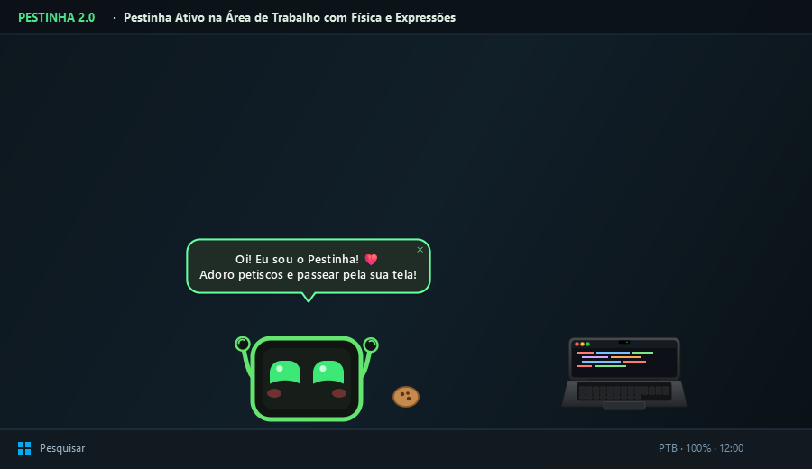
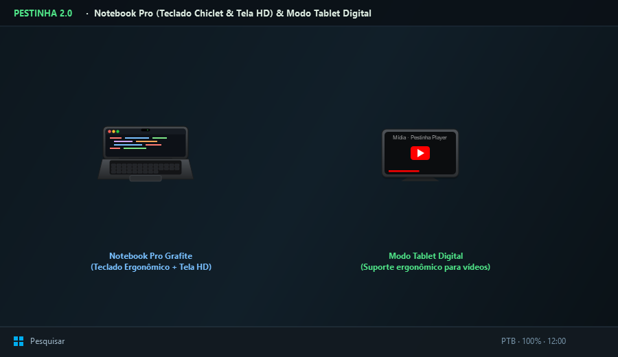
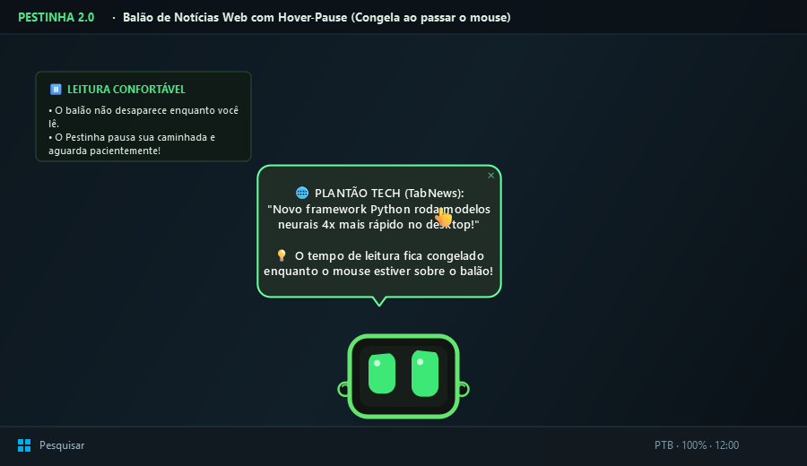
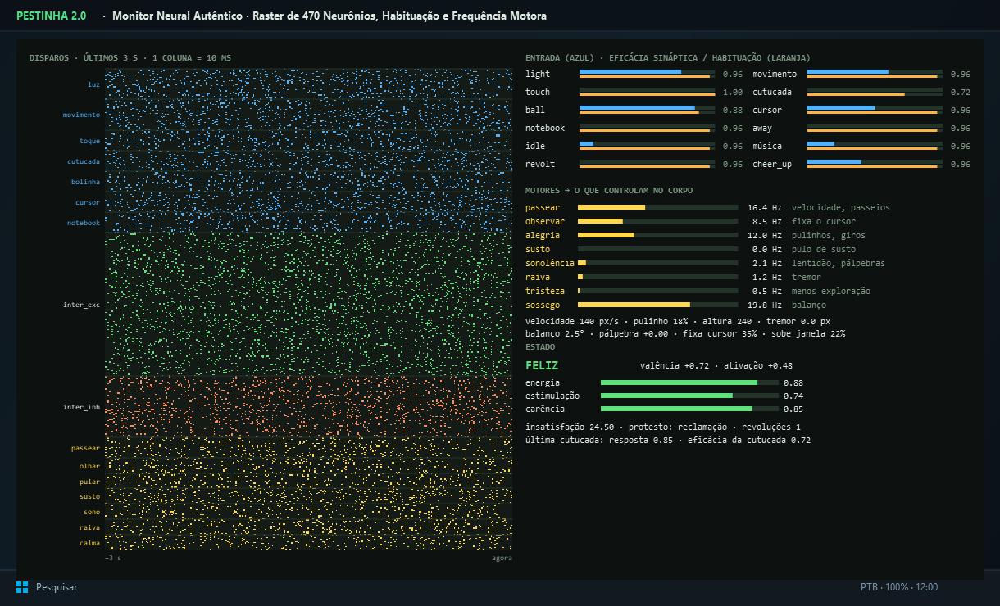
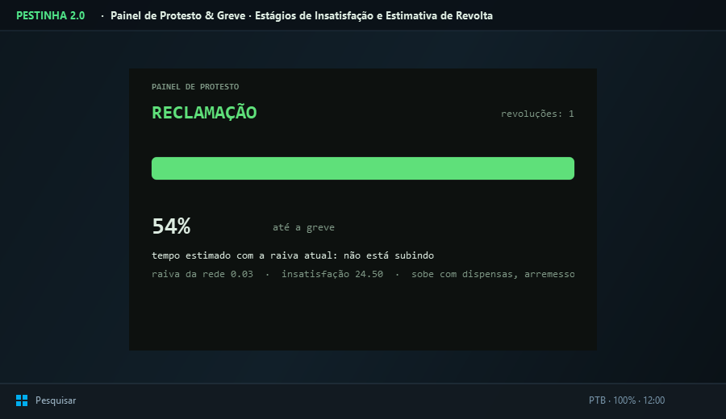

# Pestinha Pro 🐾💻

> **Seu pet virtual de mesa inteligente com cérebro biológico de 470 neurônios, membros animados, Notebook Pro interativo, Tablet Digital, busca de notícias web e menu radial de ações rápidas!**

[](https://www.python.org/)
[](https://pypi.org/project/PySide6/)
[]()
[](LICENSE)
[](https://github.com/mille-okws/pestinha)
[]()

---



O **Pestinha Pro** é um pet de mesa (*desktop virtual companion*) vivo, expressivo e autônomo. Ele mora no seu monitor, anda pela barra de tarefas, pula nas janelas do seu código, come petiscos 🍪, joga bola de tênis 🎾, trabalha no seu Notebook Pro Grafite 💻 e aprende continuamente com o seu carinho e as suas reações.

Quem comanda o corpo, as emoções e os impulsos do Pestinha é uma **rede neural biológica de 470 neurônios pulsados** (*Leaky Integrate-and-Fire*), somada a um motor de **aprendizado por reforço** (Q-learning) com **mais de 300 episódios de vivência unificada**.

---

## 💖 Créditos e Agradecimentos

Este projeto é uma edição aprimorada (**Pestinha Pro**), desenvolvida e expandida com base no projeto original de código aberto:

* 🔗 **Repositório Original no GitHub:** [https://github.com/mille-okws/pestinha](https://github.com/mille-okws/pestinha)
* 👤 **Autor Original:** [mille-okws](https://github.com/mille-okws)
* 📜 **Licença:** GNU General Public License v3.0 (GPL-3.0)

Agradecemos e creditamos calorosamente a **mille-okws** pela brilhante concepção original da simulação:
* O cérebro biológico de 470 neurônios pulsados com vazamento, canais de habituação e plasticidade neural.
* O motor de física com quique, atrito, rotação, arremesso e pouso em janelas.
* O sistema de homeostase, dinâmica de humor e os protestos/greves operárias com cartazes.

A versão **Pestinha Pro** eleva essa base com uma nova geração de funcionalidades: roda radial de ações ágil e moderna, submenus dinâmicos por aproximação (*hover*), suporte a múltiplos gadgets (Notebook Pro e Tablet Digital), busca de notícias em tempo real via IA, balões com pausa inteligente, adornos para datas comemorativas, reações musicais e testes de estabilidade aprimorados.


---

## 🚀 Principais Funcionalidades

### 🎯 1. Roda Radial de Ações (Menu Circular de Interação Rápida)
Segure o **botão direito do mouse** sobre o Pestinha por 300ms (ou arraste levemente a mira) para abrir a roda radial de interação instantânea. Ela conta com iluminação direcional, resposta tátil e **submenus dedicados de diálogo**:
* 💬 **Conversar (Submenu de Diálogo):**
  * 👍 **"Sim! / Isso aí!"**: Concorde e apoie o que ele acabou de fazer (ganha dopamina e afeição).
  * ✋ **"Não! / Para com isso!"**: Dê uma bronca amigável para parar travessuras na hora.
  * ⭐ **"Muito bem! Bom garoto!"**: Elogie com carinho e veja ele comemorar dando pulinhos!
  * 😂 **"Nada a ver, hein!"**: Tire uma onda amigável com a cara dele.
  * 🎭 **"Conta uma piada!"**: Pede uma piadinha engraçada do repertório geek dele.
  * 🤔 **"O que tá achando?"**: Pergunta o que ele está achando do seu trabalho e como está seu humor.
  * 🍪 **"Quer um petisco?"**: Oferece comida e veja os olhinhos brilharem de alegria!
* 🍪 **Dar Petisco:** Solta um biscoitinho crocante dourado para o pet comer e comemorar.
* 🥰 **Dar Carinho:** Aquece as sinapses e faz o pet fechar os olhinhos de felicidade.
* 🎾 **Jogar Bolinha:** Coloca a bolinha de tênis física perto dele para chutar e correr.
* 💻 **Notebook / Tablet (Submenu Tech):** Alterna modo Notebook, modo Tablet ou gira a tela.
* 🧠 **Central Neural:** Abre a central unificada de 4 abas com telemetria e sinapses.
* 💤 **Dormir / Soneca:** Pede para tirar uma soneca relaxante ou despertar.
* 🌐 **Mundo & Datas:** Notícias online em tempo real e fatos curiosos sobre hoje.


---

### 💻 2. Notebook Pro Grafite & Modo Tablet Digital
* **Posição Realista de Trabalho:** O pet senta atrás do notebook com a tampa grafite virada para você (com o emblema tech estilizado e reflexo da tela iluminando seu rosto).
* **100% Arrastável:** Clique com o botão esquerdo para arrastar e posicionar o notebook em qualquer lugar da tela (a posição é salva automaticamente em `panels.json`).
* **Virar a Tela para Cá:** Pelo menu do botão direito ou pela roda radial, você pode girar a tela para conferir o código compilando com partículas flutuantes e display IPS HD.
* **Modo Tablet Digital:** Alterne para um tablet elegante em suporte metálico, perfeito para assistir vídeos ou curtir músicas!



---

### 💬 3. Busca de Notícias Web & Balões com Pausa (Hover Pause)
* **Pesquisa em Momentos Ociosos:** Quando você fica algum tempo longe do teclado (`AWAY`), o Pestinha faz pesquisas em segundo plano na internet (TabNews, Wikipédia Curiosidades e suporte opcional a APIs de IA como Gemini e OpenAI).
* **Pausa Automática ao Passar o Mouse:** As notícias, piadas e balões de fala **congelam o tempo de expiração** enquanto o cursor estiver em cima, permitindo ler tudo com calma e sem pressa.
* **Pet Aguarda Pacientemente:** Enquanto você está lendo o balão, o Pestinha pausa sua caminhada e não sai correndo pela tela, mantendo o balão sempre ancorado acima dele!
* **Tolerância ao Sair:** Ao tirar o mouse, ele ainda aguarda 3 segundos extras antes de sumir suavemente, ou você pode clicar no botão `✕` para dispensar na hora.



---

### 📊 4. Monitor Neural Autêntico & Painel de Protesto
Diagnóstico biológico completo e telemetria em tempo real sincronizada com o corpo:
1. **🧠 Monitor Neural (470 Neurônios Pulsados):**
   * **Raster Plot em Tempo Real:** Mostra os disparos dos 470 neurônios dos últimos 3 segundos (colunas de 10 ms), agrupados por população: Sensores (azul), Interneurônios (verde/laranja) e Motores (amarelo).
   * **Canais Sensoriais & Habituação Sináptica:** Leitura da entrada de cada sensor (luz, movimento, toque, cutucada, bolinha, cursor, notebook) e eficácia sináptica em tempo real.
   * **Motores & Efeito Físico:** Atividade motora em Hz e parâmetros corporais (velocidade px/s, pulinho %, balanço, tremor, pálpebra e fixação no cursor).
   * **Homeostase & Emoção:** Valência, ativação, energia, estimulação e carência.
2. **🪧 Painel de Protesto & Greve:**
   * Estágio atual de insatisfação (Calmo, Reclamação, Manifestação, Greve, Revolução).
   * Barra de insatisfação com limiares de greve, contador de revoluções e tempo estimado (ETA).





---

### 🦾 5. Membros Animados & Físicos
* **Perninhas com Caminhada Real:** Pernas com passos cadenciados que usam a barra de tarefas ou janelas como base sólida (sem parecer uma aranha deslizando!).
* **Bracinhos com Gestos:** Comemora pulando de alegria (`cheer`), acena com as mãozinhas, coça a cabeça quando confuso, cruza os braços e segura a bolinha no colo.

---

### 🎉 6. Datas Comemorativas & Contexto Musical
* **Adornos Sazonais Automáticos:**
  * 🌽 **São João / Festas Juninas:** Chapéu de palha trançado.
  * 🎅 **Natal:** Gorro do Papai Noel.
  * 🐰 **Páscoa:** Orelhinhas de coelho felpudas.
  * 🎭 **Carnaval:** Máscara carnavalesca festiva.
  * 💻 **Dia do Dev:** Óculos escuros estilo Matrix.
* **Reconhecimento Musical & Vídeos:**
  * 🎸 **Rock / Metal:** Bate cabeça (headbanging) e solta riffs de guitarra.
  * ☕ **Lo-Fi / Chill:** Fica calmo curtindo uma caneca de café quente.
  * 🍿 **Vídeos / Streaming:** Pega o balde de pipoca para assistir com você!

---

## 🎮 Guia de Controles e Interações

| Ação | Como fazer | Efeito |
|---|---|---|
| **Roda de Opções Radial** | **Segurar Botão Direito** por 300ms sobre o pet | Abre o menu circular de ações; arraste na direção da opção e solte para ativar |
| **Menu Tradicional** | Clique rápido com o botão direito | Abre o menu de contexto completo com todas as opções |
| **Carinho** | Passar o mouse repetidamente de um lado para o outro | O pet fecha os olhinhos de prazer, ganha carinho e aprende a gostar de você |
| **Cutucar** | Clique rápido com o botão esquerdo | Cutucada imediata que desperta e estimula o pet |
| **Arrastar / Arremessar** | Clicar com o esquerdo, segurar e soltar | O pet é erguido e arremessado com a velocidade do movimento |
| **Girar o Corpo** | Rodinha do mouse (scroll) | Gira o pet no ar ou no chão |
| **Mover o Notebook** | Clicar e arrastar com o botão esquerdo no notebook | Posiciona o Notebook Pro livremente pela tela |
| **Opções do Notebook** | Botão direito no notebook | Vira a tela para cá / vira para o pet / alterna modo Tablet Digital |
| **Pausa no Balão** | Colocar o mouse sobre o balão de fala | Congela o balão na tela para leitura confortável |
| **Atalho de Pânico** | `Ctrl + Alt + Shift + B` | Fecha o programa instantaneamente |

---

## 💻 Como Instalar e Rodar

### 📦 Opção 1: Instalador Oficial Windows `.exe` (Sem precisar de Python!)
Se você quer apenas usar e brincar com o Pestinha Pro no Windows, não precisa instalar o Python nem usar o terminal:
1. Acesse a pasta [`instalador/saida/`](file:///C:/Users/Moa/Documents/GitHub/pestinha%20pro/instalador/saida/).
2. Dê um duplo clique em **`Pestinha-Pro-2.0.0-Instalador.exe`**.
3. Siga o assistente de instalação (cria atalho na Área de Trabalho e no Menu Iniciar automaticamente).
4. O instalador embute o interpretador Python completo, a interface gráfica PySide6 e todas as bibliotecas necessárias!

---

### 🛠️ Opção 2: Execução a partir do Código-Fonte (Desenvolvedores)
Para quem deseja modificar o código ou contribuir com o projeto:
* **Requisitos:** Python 3.11 ou superior (testado e otimizado para Python 3.15 64-bit).

```bash
# 1. Clone o repositório
git clone https://github.com/mille-okws/pestinha.git
cd pestinha

# 2. Instale as dependências
pip install -r requirements.txt

# 3. Inicie o Pestinha Pro
python main.py
```

*Para abrir direto na tela de configurações e personalização:*
```bash
python main.py --configurar
```

*Para recompilar o instalador `.exe`:*
```powershell
.\instalador\compiler.bat
```

---

## 🛡️ Privacidade & Como Subir para o GitHub com Segurança

O Pestinha é **100% Offline-First e Seguro**. Ele roda exclusivamente no seu computador local e monitora apenas dados neutros de contexto (tempo ocioso, nome do executável da janela ativa para saber se você está programando ou assistindo a um vídeo). **Nunca** grava suas telas, **nunca** lê o que você digita e **nunca** envia informações para servidores externos.

O arquivo `.gitignore` do projeto está blindado para que seus dados pessoais e de uso **nunca** vão para o repositório:
* A pasta `memory/` (onde ficam seus logs, sua rotina diária no PC, timeline.csv e os pesos do pet) é completamente ignorada.
* Arquivos `.env` e chaves de API nunca são comitados.

### Comandos para subir no seu GitHub:
```powershell
# 1. Inicialize o repositório (se ainda não tiver feito)
git init

# 2. Adicione o repositório original como upstream para sincronização
git remote add upstream https://github.com/mille-okws/pestinha.git

# 3. Adicione o seu repositório remoto pessoal
git remote add origin https://github.com/SEU_USUARIO/pestinha.git

# 4. Confira que memory/ e arquivos sensíveis NÃO aparecem (protegidos pelo .gitignore)
git status

# 5. Adicione os arquivos do projeto e crie o commit
git add .
git commit -m "feat: Pestinha Pro v2.0 - menu radial de acoes, Notebook Pro, Tablet Digital, noticias web, datas comemorativas e instalador exe"

# 6. Conecte ao branch principal e envie
git branch -M main
git push -u origin main
```

---

## 📁 Estrutura de Arquitetura

O projeto adota uma arquitetura em camadas estritas (`core < sense < body < world < mind < ui < controle < app`):

```
pestinha-pro/
├── pestinha/
│   ├── core/         # Matemática pura, redes neurais, emoções e homeostase (sem Qt/OS)
│   ├── sense/        # Sensores de janelas, tempo ocioso, contexto e notícias web
│   ├── body/         # Janela do pet, física, membros (pernas/braços) e adornos sazonais
│   ├── world/        # Objetos interativos: Notebook Pro, Tablet Digital, petiscos e popups
│   ├── mind/         # Decisões autônomas: sono, mesa/trabalho, travessuras e protesto
│   ├── ui/           # Roda radial de ações, Central unificada de humor/neural e onboarding
│   ├── controle/     # Sessão, atalhos, salvamento atômico e interações do menu
│   └── app.py        # Ponto central orquestrador do ciclo de vida
├── pets/             # Definições do personagem, memes, recadinhos e cartazes
├── assets/           # Texturas neutras comuns e sons
├── instalador/       # Script Inno Setup e compiler.bat para gerar o instalador .exe
├── docs/prints/      # Capturas de tela em alta resolução para a documentação
├── tests/            # Suíte completa de mais de 400 testes unitários e de integração
└── main.py           # Ponto de entrada com trava de instância única
```

---

## 🧪 Testes Automatizados

O Pestinha possui uma das suítes de testes mais completas para pets virtuais:
```bash
python -m pytest -q
```
* **400+ testes automatizados** cobrindo física, camadas arquiteturais, rede neural, renderização de membros, persistência atômica, fusão de memórias e busca web.

---

## 📄 Licença

Distribuído sob a licença **GNU General Public License v3.0** (GPL-3.0). Consulte o arquivo [LICENSE](LICENSE) para obter mais informações.
